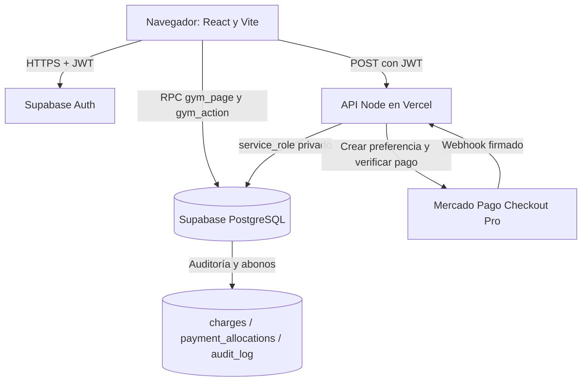

# Arquitectura de GymControl EV03

**Distribución:** `src/` presentación (React); `src/lib/supabase.js` adaptador del cliente; `api/` lógica que necesita secreto del servidor; `supabase/*.sql` lógica y persistencia. No almacenar secretos en código del navegador.

**Controles de cobro:** un cargo tiene monto total, abonos y saldo; pago presencial se registra en transacción PostgreSQL; el pago online solo se confirma con respuesta oficial del proveedor, HMAC del webhook y función RPC con permisos `service_role`. El retorno del usuario no cambia el saldo.

**Responsabilidades de perfiles:** administrador crea cargos, administra miembros, equipos, clases y reportes; recepción registra fichas, entradas, pagos y reservas; socio consulta su estado, asistencias, reservas y deuda personal y puede iniciar checkout únicamente si está habilitado.

**Pendientes contractuales:** despliegue Vercel, claves reales del merchant, configuración webhook, políticas de recuperación y backup, SII/DTE, pruebas de carga, revisión de seguridad y aceptación con usuarios.
